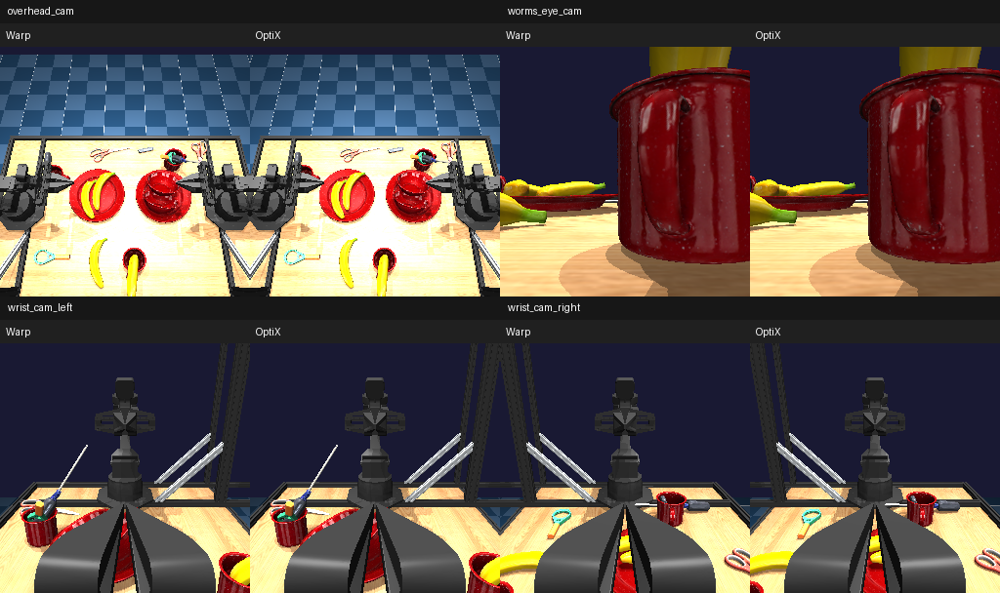

# ALOHA clutter vision: Warp versus OptiX



The comparison above renders the benchmark's initial replay pose at 256×256 per camera for inspection. Timings below use the benchmark's specified **64×64** resolution. Both use overhead, worms-eye, left-wrist, and right-wrist cameras, with **RGB, depth, segmentation, and shadows** enabled. All four cameras render in each call.

## Rendering performance

RTX PRO 6000 Blackwell Workstation Edition, driver **595.91.07**, Warp 1.15.0, MuJoCo 3.12.1, OptiX SDK 9.0.0; September 15, 2026. Medians of seven repeats of ten calls, after warmup. CUDA-event latency includes CPU submission gaps; context creation, compilation, image downloads, and physics stepping are excluded. Worlds share the initial `pick_clutter.npz` qpos. Every frame still refits and builds the hardware hierarchy. These are rendering measurements at a fixed replay pose, not a moving rollout benchmark.

Milliseconds per batch:

| Worlds | Camera images | Warp render | OptiX render | Render speedup | Warp total | OptiX total | Captured Warp total |
| ---: | ---: | ---: | ---: | ---: | ---: | ---: | ---: |
| 1 | 4 | 0.996 | 0.195 | 5.11× | 1.011 | 0.215 | 1.004 |
| 128 | 512 | 11.229 | 0.957 | 11.74× | 11.196 | 0.987 | 11.211 |
| 512 | 2,048 | 42.429 | 4.779 | 8.88× | 42.616 | 4.533 | 42.583 |
| 2,048 | 8,192 | 167.986 | 15.120 | **11.11×** | 168.636 | 15.227 | 168.612 |

OptiX render includes the native batch instance-hierarchy build. Total adds the Warp BVH refit and GPU instance packing. Component and total medians are measured independently, so they need not sum exactly; the 512-world total is lower than its separately measured render time. Desktop activity and unlocked GPU clocks introduce variation. [Raw results and ranges](clutter_r595.json).

At 2,048 worlds, full-frame speedup is **11.08×**. OptiX produces approximately **538,000 camera images/second** including hierarchy maintenance, or **65.7 batches/second**, versus Warp's 48,600 images/second and 5.93 batches/second. Captured Warp has nearly identical latency here; this scene is dominated by GPU work.

## Visual agreement

The displayed 256×256 first-world comparison has identical segmentation, maximum depth difference **2.86 micrometers**, and maximum RGB channel difference **36/255**. See [preview measurements](clutter_preview_r595.json) and [individual images](clutter_images_256).

At the benchmark's 64×64 resolution:

| Worlds | Segmentation differences | Total pixels | Maximum depth difference | Maximum RGB channel difference |
| ---: | ---: | ---: | ---: | ---: |
| 1 | 0 | 16,384 | 0.54 micrometers | 1 |
| 128 | 18 | 2,097,152 | 0.563 m | 242 |
| 512 | 92 | 8,388,608 | 0.563 m | 242 |
| 2,048 | 541 | 33,554,432 | 0.563 m | 242 |

The 2,048-world segmentation difference rate is **0.00161%**. Spatial translations used to separate worlds introduce rounding and can change boundary surface selection. Large isolated depth/color differences remain, so this is not pixel-perfect parity. The first-world preview does not demonstrate agreement for every translated world. [Native-resolution first-world comparisons](clutter_images).

## Driver upgrade and graph capture

The upgraded R595 driver successfully loads the unmodified upstream `warp_optix` addon with OptiX 9.1 and Warp 1.17. At upstream commit `49e540d381d580f6aea1b1df81aef800d1cab77a`, the triangle probe verifies eager rendering but graph replay raises CUDA error 700. Disabling Warp's memory pool produces the same failure. This rules out the old unsupported-ABI problem, but does not establish the root cause of graph replay failure.

A separate native batch-renderer probe, using OptiX 9.0 on R595 and temporarily bypassing the capture guard in its own process, successfully captures but fails image verification on replay. The production guard remains enabled. **Hardware rendering inside a graph is still unresolved; the driver upgrade alone did not fix it.** Refit/instance packing and primitive-only rendering remain capturable. The upstream addon remains an isolated experiment, not a new project dependency.

## Reproduce

Assemble the pinned assets with the existing `benchmarks/run.py` asset helper, or use a previously assembled `aloha_clutter_vision` directory. Its asset commits are specified in `benchmarks/aloha/__init__.py`.

```sh
OPTIX_PATH=/path/to/optix-9.0 uv run benchmarks/render_backends.py \
  /path/to/aloha_clutter_vision/scene_clutter.xml \
  --worlds 1 128 512 2048 --resolution 64 \
  --cameras overhead_cam worms_eye_cam wrist_cam_left wrist_cam_right \
  --shadows --replay benchmarks/aloha/pick_clutter.npz --warp-graph \
  --images benchmarks/optix/clutter_images \
  --output benchmarks/optix/clutter_r595.json
```

For larger comparison images, use `--worlds 1 --resolution 256` and separate image/output paths. Each saved camera image places Warp on the left and OptiX on the right. The contact sheet above combines those four camera comparisons.

Validation after the driver upgrade: 57 non-OpenGL OptiX tests passed, followed by all 10 native-MuJoCo comparison cases using `MUJOCO_GL=egl` (67 cases total). Ruff and whitespace checks passed. The benchmark completed all four requested batch sizes and the 256×256 preview; the contact sheet was visually inspected.
