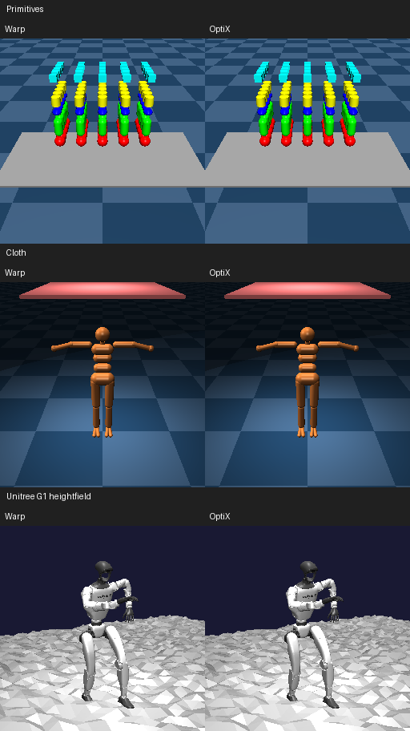

# Other rendering benchmarks: Warp versus OptiX



These are all three remaining benchmark configurations whose `function` is `render`: primitives, cloth, and Unitree G1 on a heightfield. See [ALOHA clutter](CLUTTER.md) for the fourth rendering benchmark.

The previews above use 256×256 for inspection. Performance measurements use each benchmark's configured **one 64×64 camera, textures enabled, shadows disabled**. Primitives and cloth produce RGB + depth; G1 produces RGB only. Segmentation is disabled in all three, matching their benchmark settings and CLI defaults. The cloth executable configuration specifies **32 worlds**, although its README still says 2,048; these results follow the executable configuration.

## Performance

RTX PRO 6000 Blackwell Workstation Edition, driver **595.91.07**, Warp 1.15.0, MuJoCo 3.12.1, OptiX SDK 9.0.0. Medians of seven repeats of ten calls after warmup, using CUDA events. CPU submission gaps are included; physics stepping, compilation, image downloads, and context creation are excluded. GPU clocks were not locked. Scenes remain at their initial pose; G1 uses the initial qpos from `shuffle_dance.npz`. All worlds share that pose. These are fixed-state rendering measurements, not moving rollout timings; cloth is initially flat above the mannequin.

Milliseconds per batch:

| Scene | Worlds | Warp render | OptiX render | Render speedup | Warp total | OptiX total | Captured Warp total |
| --- | ---: | ---: | ---: | ---: | ---: | ---: | ---: |
| Primitives | 1 | 0.083 | 0.079 | 1.05× | 0.099 | 0.100 | 0.039 |
| Primitives | 128 | 0.084 | 0.088 | 0.95× | 0.105 | 0.109 | 0.092 |
| Primitives | 8,192 | 3.562 | 3.561 | 1.00× | 3.502 | 3.598 | 3.503 |
| Cloth | 1 | 0.087 | 0.079 | 1.10× | 0.181 | 0.183 | 0.101 |
| Cloth | 16 | 0.080 | 0.080 | 1.00× | 0.182 | 0.183 | 0.120 |
| Cloth | 32 | 0.081 | 0.080 | 1.02× | 0.186 | 0.185 | 0.149 |
| G1 heightfield | 1 | 0.199 | 0.128 | 1.56× | 0.212 | 0.153 | 0.205 |
| G1 heightfield | 128 | 1.167 | 0.233 | 5.00× | 1.188 | 0.260 | 1.146 |
| G1 heightfield | 8,192 | 60.955 | 4.059 | 15.02× | 61.113 | 4.028 | 61.088 |

“Total” includes refit and rendering. OptiX render includes its native instance-hierarchy build. Components and totals are measured separately, so their medians need not sum: in particular G1's total is slightly lower than its separately measured render time. Raw files retain min/median/max values.

- **G1, 8,192 worlds:** 15.02× faster rendering and 15.17× faster total frames. Approximately 2.03 million 64×64 images/second including scene maintenance, versus Warp's 134,000. Captured Warp is also about 61.09 ms.
- **Primitives, 8,192 worlds:** rendering is effectively equal, about 3.56 ms. There are no triangle assets; `backend="optix"` uses the ordinary Warp renderer.
- **Cloth, 32 worlds:** rendering is effectively equal, about 0.08 ms. Deforming flex triangles and analytic primitives still use the shared software intersection path. No RT-core acceleration is claimed for this scene. Capturing the Warp frame reduces host submission overhead, from about 0.186 to 0.149 ms. The OptiX-selected software fallback also supports capture, though only Warp capture was timed here.

Hardware mesh/heightfield render capture remains unresolved on this runtime; see the [R595 investigation](CLUTTER.md#driver-upgrade-and-graph-capture).

## Image agreement

Primitives and cloth have **identical RGB and depth** for every tested batch size and for the 256×256 previews. G1's RGB maximum channel difference is 0, 19, and 71 out of 255 at 1, 128, and 8,192 worlds respectively. Its 256×256 first-world preview differs by at most 1. The first-world previews do not establish agreement for all spatially translated worlds; boundary differences can increase with batch size. G1 depth and segmentation were disabled to match the benchmark, so no parity claim is made for those channels.

Individual larger comparisons:

- [Primitives](other_previews/primitives_1w_camera_0.png)
- [Cloth](other_previews/scene_1w_camera_0.png)
- [G1 heightfield](other_previews/scene_hfield_1w_tracking.png)

Raw measurements: [primitives](primitives_r595.json), [cloth](cloth_r595.json), [G1](g1_r595.json). Preview measurements: [primitives/cloth](other_previews_r595.json), [G1](g1_preview_r595.json). Native 64×64 comparisons are in [other_images](other_images).

## Reproduce

```sh
OPTIX_PATH=/path/to/optix-9.0 uv run benchmarks/render_backends.py \
  benchmarks/render/primitives.xml --worlds 1 128 8192 --resolution 64 \
  --no-seg --warp-graph --images benchmarks/optix/other_images/primitives \
  --output benchmarks/optix/primitives_r595.json

OPTIX_PATH=/path/to/optix-9.0 uv run benchmarks/render_backends.py \
  benchmarks/cloth/scene.xml --worlds 1 16 32 --resolution 64 \
  --no-seg --warp-graph --images benchmarks/optix/other_images/cloth \
  --output benchmarks/optix/cloth_r595.json

OPTIX_PATH=/path/to/optix-9.0 uv run benchmarks/render_backends.py \
  /path/to/unitree_g1_hfield_render/scene_hfield.xml \
  --worlds 1 128 8192 --resolution 64 --no-depth --no-seg --warp-graph \
  --replay benchmarks/unitree_g1/shuffle_dance.npz \
  --images benchmarks/optix/other_images/g1 --output benchmarks/optix/g1_r595.json
```

Assemble G1's assets using the existing benchmark asset helper and the pinned configuration in `benchmarks/unitree_g1/__init__.py`. For previews, use `--worlds 1 --resolution 256` and separate image/output paths. Each comparison places Warp on the left and OptiX on the right.

The benchmark helper now supports `--no-depth` and `--no-seg` to preserve each benchmark's output settings. Disabled-channel error metrics are recorded as null. All three benchmark sweeps and all previews completed successfully; Ruff and whitespace checks passed. No renderer implementation changes were needed for these measurements.
